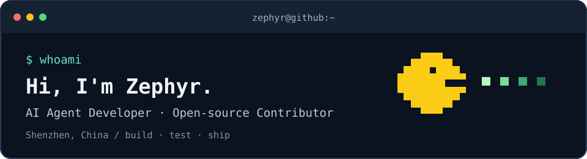

  

  
  
  
  

### `$ whoami`

I build AI agents and developer tools. My open-source work focuses on agent runtime behavior, scheduling, memory, and integrations. I contribute fixes with reproducible cases and regression tests.

📍 Shenzhen, China &nbsp;·&nbsp; ✉️ [Zephyr05Wang@qq.com](mailto:Zephyr05Wang@qq.com)

### `$ git log --merged`

15 merged upstream PRs across 5 projects as of 14 November 2026.

| Project | Stars | Merged PRs |
| :--- | :--- | :--- |
| [OpenClaw](https://github.com/openclaw/openclaw) |  | [Reject incompatible working-directory flags in cron edits](https://github.com/openclaw/openclaw/pull/198588) [Preserve Feishu attachment filenames containing semicolons](https://github.com/openclaw/openclaw/pull/196097) [Restore native process detection on macOS](https://github.com/openclaw/openclaw/pull/194106) |
| [Dify](https://github.com/langgenius/dify) |  | [Honor the local hostname during SMTP STARTTLS](https://github.com/langgenius/dify/pull/45909) [Remove unnecessary sorting from pagination counts](https://github.com/langgenius/dify/pull/45735) |
| [DeerFlow](https://github.com/bytedance/deer-flow) |  | [Allow editing schedules with malformed stored intervals](https://github.com/bytedance/deer-flow/pull/8188) [Count model calls independently of reused message IDs](https://github.com/bytedance/deer-flow/pull/8050) [Reject duplicate fact IDs during memory imports](https://github.com/bytedance/deer-flow/pull/8151) [Require explicit facts in replacement imports](https://github.com/bytedance/deer-flow/pull/8131) [Fall back to document delivery when Telegram rejects a photo](https://github.com/bytedance/deer-flow/pull/8056) [Check recipient-level status for DingTalk file delivery](https://github.com/bytedance/deer-flow/pull/8089) |
| [NiceGUI](https://github.com/zauberzeug/nicegui) |  | [Prevent outdated asynchronous validation results](https://github.com/zauberzeug/nicegui/pull/6455) |
| [Dify Plugins](https://github.com/langgenius/dify-official-plugins) |  | [Close embedded QR-code files before cleanup](https://github.com/langgenius/dify-official-plugins/pull/4162) [Preserve significant whitespace in regex extraction](https://github.com/langgenius/dify-official-plugins/pull/4160) [Apply JSON replacements to root values](https://github.com/langgenius/dify-official-plugins/pull/4158) |

[All merged PRs](https://github.com/search?q=author%3AWang-Zephyr+is%3Apr+is%3Amerged&type=pullrequests) · [Open PRs](https://github.com/search?q=author%3AWang-Zephyr+is%3Apr+is%3Aopen&type=pullrequests)

### `$ arcade --play`

<picture>
  <source media="(prefers-color-scheme: dark)" srcset="https://raw.githubusercontent.com/Wang-Zephyr/Wang-Zephyr/output/pacman-contribution-graph-dark.svg">
  <source media="(prefers-color-scheme: light)" srcset="https://raw.githubusercontent.com/Wang-Zephyr/Wang-Zephyr/output/pacman-contribution-graph.svg">
  
</picture>

Contribution animation updates daily with <a href="https://github.com/abozanona/pacman-contribution-graph">pacman-contribution-graph</a>.

